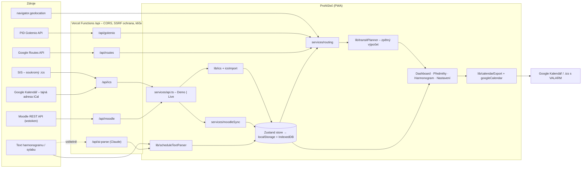

# Architektura datového toku

Stihnu je klientská PWA (React + TypeScript) s tenkou serverovou vrstvou na Vercelu. Všechna studijní data žijí
v prohlížeči; server slouží jen jako bezpečná proxy k externím API, která nepodporují CORS nebo vyžadují tajný klíč.



## 1. SIS a Google Kalendář → rozvrh a budovy

1. Odkaz (SIS rozvrh, tajná adresa Google Kalendáře) se stáhne přes `/api/ics` (SIS ani Google neposílají CORS);
   nahraný soubor se zpracuje přímo v prohlížeči.
2. `lib/ics.ts` – parser RFC 5545: skládání řádků, escapování, `TZID` (IANA i Windows názvy) převedené přes `Intl` na
   správný okamžik i přes změnu času, `RRULE` (DAILY/WEEKLY/MONTHLY/YEARLY, `INTERVAL`, `COUNT`, `UNTIL`, `BYDAY`),
   `EXDATE` a přesunuté výskyty (`RECURRENCE-ID`).
3. `lib/icsImport.ts` – z `SUMMARY`/`DESCRIPTION` vytáhne kód předmětu (`JSB065`), název a typ výuky,
   z `LOCATION` místnost a budovu (`lib/buildings.ts`: aliasy, vzor kódu místnosti, ruční mapování).
   Budova nese **cílové zastávky MHD s pěším časem** – vstup pro dopravní engine.
4. Import nahrazuje dřívější import ze stejného zdroje (zdroj pravdy je kalendář), takže opakovaná synchronizace nic nezdvojí.

## 2. Moodle → povinnosti a materiály

`services/moodleSync.ts` volá přes `/api/moodle` (proxy povoluje jen čtecí funkce):

| Krok | Funkce | Výsledek |
| --- | --- | --- |
| 1 | `core_webservice_get_site_info` | ověření tokenu, `userid` |
| 2 | `core_enrol_get_users_courses` | kurzy → předměty (párování podle kódu, ID kurzu, názvu) |
| 3 | `mod_assign_get_assignments` | odevzdávárny → povinnosti s deadlinem + přílohy zadání |
| 4 | `core_calendar_get_action_events_by_timesort` | testy, kvízy a další termíny |
| 5 | `core_course_get_contents` | prezentace, PDF a odkazy z týdenních sekcí → materiály |

Každá položka má stabilní `externalId` (`moodle:assign:123`, `moodle:file:{contextId}:{soubor}`), takže se při další
synchronizaci aktualizuje, nezdvojí a zachová odškrtané podúkoly i ruční vazby. Soubory se otevírají přímo z Moodlu –
k `fileurl` se v okamžiku kliknutí připojí `token` (token se nikam neukládá mimo prohlížeč).

## 3. Harmonogram a sylaby → milníky a povinnosti

`lib/scheduleTextParser.ts` běží okamžitě a offline: normalizuje text (pomlčky, nezalomitelné mezery, tabulky),
najde datové tokeny (číselné, slovní měsíce v obou pádech, rozsahy, „od–do“, ISO), časy a váhy v %, odvodí akademický rok
(i rok u dat bez roku – rozsahy vždy běží dopředu), název řádku a kategorii podle klíčových slov.
Volitelně `/api/ai-parse` (Claude, strukturovaný výstup validovaný schématem) vrátí stejné položky přesněji.
Student položky zkontroluje a uloží jako milníky (harmonogram) nebo povinnosti předmětu s vahou a checklistem.

## 4. Dopravní engine – „Reverse Transit Math“

Golemio vrací polohy vozů a odjezdové tabule, **ne** vyhledání trasy A → B. Engine proto kombinuje:

1. **Google Routes API (TRANSIT)** – pokud je klíč: itineráře s přestupy pro příjezd k `začátek − rezerva`
   (a dva dřívější časy), následně **obohacené z Golemia**: pro první jízdu se v odjezdové tabuli najde stejný spoj
   (linka + plánovaný odjezd ± 2 min) a doplní se zpoždění, klimatizace, nízkopodlažnost a `tripId`.
2. **Golemio „přímé spoje“** – bez Google klíče: zastávky v okolí GPS (`/v2/gtfs/stops?latlng`) → odjezdové tabule
   (`/v2/pid/departureboards`) → pro každou linku a směr zastávkové časy spoje (`/v2/gtfs/trips/{id}`, cache) →
   spoje, které dojedou na cílovou zastávku budovy, s dobou jízdy a predikovaným odjezdem.
3. **Odhad** podle vzdálenosti, když nejsou klíče ani data (vždy označený).

`lib/transitPlanner.ts` pak čistě a testovatelně spočítá:

```
deadline       = začátek − rezerva (5 min)
příchod        = predikovaný příjezd na zastávku + chůze do budovy
vyhovuje       = příchod ≤ deadline   a   odchod ≥ teď
poslední spoj  = vyhovující s nejpozdějším odchodem
doporučený     = nejpozdější s rezervou navíc (pohodlí), případně klimatizovaný
odchod         = predikovaný odjezd − chůze z polohy na zastávku
stav           = > 20 min zelená · 10–20 min oranžová · < 10 min červená · nic nevyhovuje → „nestihneš“ + nejrychlejší pozdní příjezd
```

Odpočet se přepočítává každou sekundu, data se obnovují každých 15 s (demo) / 30 s (live), zpoždění se tak průběžně promítá
do toho, zda spoj ještě stihneš.

## 5. Stav, perzistence a backend

- `store/appStore.ts` (Zustand + `persist`) – předměty, rozvrh, povinnosti s podúkoly, materiály, milníky, nastavení.
  Ukládá se do `localStorage` (se záložní pamětí pro anonymní okna); nahrané soubory do IndexedDB (`lib/blobStore.ts`).
- `lib/persistence.ts` – volitelná write-through synchronizace na vlastní backend (`VITE_SYNC_URL`, GET/PUT `/state`).
- `services/api.ts` – jediná fasáda pro data zvenčí; `createApi(settings)` vrátí Demo nebo Live implementaci.

## 6. Demo / Sandbox

- `services/demo/network.ts` + `transitSim.ts` – síť PID (tramvaje 22 a 18, metro A/B/C) s intervaly podle denní doby,
  deterministickými trip ID, plynule se měnícím zpožděním, klimatizací a nízkopodlažností podle vozového parku
  a vyhledáním spojení s jedním přestupem. Výstup má stejný tvar jako Live (`Itinerary`).
- `services/demo/moodleDemo.ts` – simulovaný Moodle se stejným tvarem odpovědí, takže demo prochází stejnou synchronizací.
- `services/demo/seed.ts` – předměty FSV UK, rozvrh (Hollar, Jinonice, Opletalova), rozpracované seminárky,
  materiály z Moodlu a harmonogram roku. Demo položky se každý den posouvají na dnešek.
- `store/clockStore.ts` – simulované hodiny startující ve 13:05, aby byl odpočet k semináři ve 14:00 vidět kdykoli.

## 7. Export do kalendáře

`lib/calendarExport.ts` převádí povinnosti, milníky i rozvrh na jednotný `CalendarItem` a nabízí:
`.ics` (RFC 5545, zalamování na 75 oktetů, `VALARM` připomínky), přímý odkaz do Google Kalendáře a
`lib/googleCalendar.ts` – zápis přes Google Calendar API (Google Identity Services, token model) s připomínkami.

## 8. PWA

Manifest s ikonami a zkratkami, service worker (`public/sw.js`): síť první pro navigaci s offline zálohou,
cache první pro hashované assety; build generuje `precache-manifest.json`, takže po prvním načtení funguje offline
i každá líně načítaná sekce. `/api/*` se nikdy necachuje.
