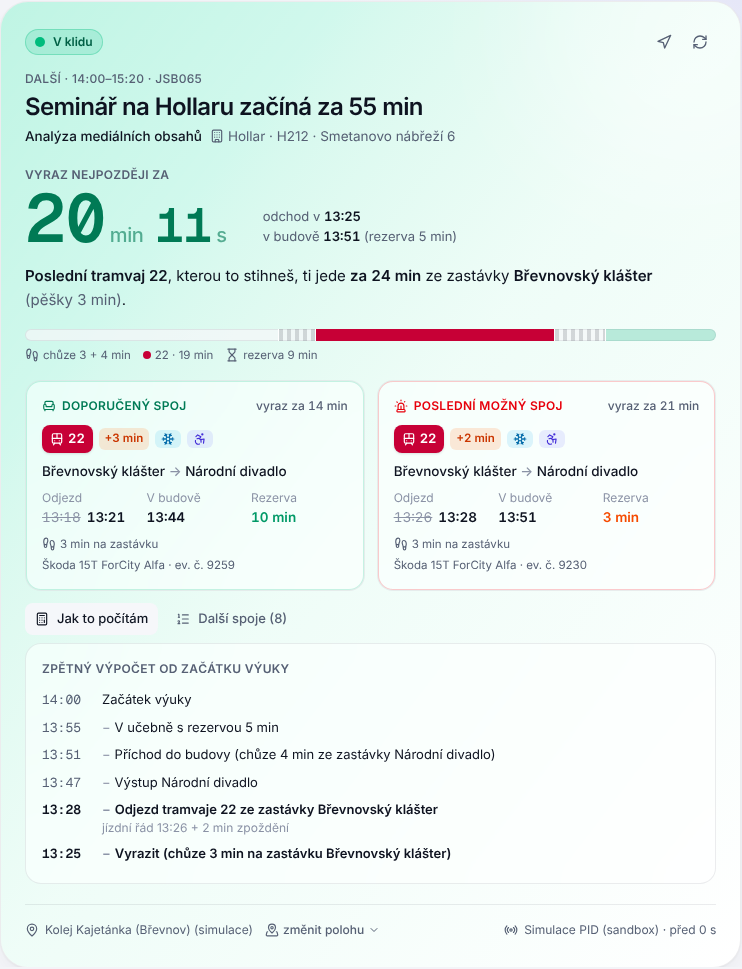

# Stihnu – rozvrh, deadliny a poslední spoj MHD v jedné aplikaci

PWA pro vysokoškoláky v Praze (primárně ekosystém Univerzity Karlovy – SIS, Moodle, Google Kalendář a PID).
Filozofie **Zero‑Friction & Action‑First**: žádné ruční přepisování termínů a místo „za 55 minut máš seminář“
rovnou **odpočet do odchodu na poslední spoj MHD**, kterým to z aktuální polohy ještě stihneš – včetně živého
zpoždění, klimatizace a nízkopodlažnosti z PID Golemio.


| Hero „Poslední záchrana“ | Mobil | Tmavý režim |
| --- | --- | --- |
|  |  |  |

> Aplikace je hned po spuštění plně interaktivní v **Demo / Sandbox režimu** (realistická data FSV UK, simulace PID,
> simulovaný Moodle i SIS). Do **Live režimu** se přepíná jedním kliknutím.

---

## Co umí

### 1. Dnes & doprava – chytrý dopravní navigátor
- **Zpětný výpočet** od začátku výuky: `začátek − rezerva − chůze ze zastávky − jízda MHD (se zpožděním) − chůze z GPS na zastávku`.
  Rozpis výpočtu je vidět pod tlačítkem *Jak to počítám*.
- **Dva spoje**: *Doporučený* (s pohodlnou rezervou) a *Poslední možný* (Last Call) s velkým odpočtem:
  „Seminář na Hollaru začíná za 55 min. Poslední tramvaj 22, kterou to stihneš, ti jede za 24 min ze zastávky Břevnovský klášter.“
- U spoje: **zpoždění** (`+2 min` oranžově, `0 min` zeleně, „dle JŘ“ bez online polohy), **❄ klimatizace**, **♿ nízkopodlažnost**, typ vozu.
- **Barevná sémantika**: zelená > 20 min do odchodu, oranžová 10–20 min, červená < 10 min (pulzuje); stav „MHD už to nestihneš“ s nejrychlejším
  náhradním příjezdem a předvyplněnou omluvou; „Jsi na místě“, když už stojíš u budovy.
- Poloha přes `navigator.geolocation` (Live), nebo simulovaná / uložená místa. Volby: jen nízkopodlažní spoje, preferovat klimatizaci, rychlost chůze, rezervy.
- Dnešní rozvrh (kliknutím zvolíš cílovou výuku), nejbližší deadliny z Moodlu/SISu, progress předmětů a milníky harmonogramu.

### 2. Propojit studium – tři cesty bez nastavování
- **A · Moodle REST API** – 3krokový návod (Předvolby → Klíče zabezpečení → klíč *Moodle mobile web service*), adresa Moodlu + `wstoken`.
  Volá `core_webservice_get_site_info`, `core_enrol_get_users_courses`, `mod_assign_get_assignments`,
  `core_calendar_get_action_events_by_timesort` a `core_course_get_contents`. Prezentace a PDF z týdenních sekcí se otevírají
  jedním klikem (k `fileurl` se připojí `?token=WSTOKEN`). Opakovaná synchronizace nic nezdvojí a zachová odškrtané podúkoly.
- **B · SIS / Google Kalendář (.ics)** – soukromý iCal odkaz, tajná adresa Google Kalendáře, nebo nahraný soubor.
  Parser RFC 5545 (RRULE, EXDATE, přesunuté hodiny, časová pásma) → předměty, časy a **místnosti → budovy** (`H212` → Hollar, `J3014` → Jinonice).
  Neznámé místnosti jde jedním výběrem přiřadit budově.
- **C · Chytrý parser harmonogramu a sylabů** – vložíš text z webu fakulty nebo ze SISu, okamžitě (offline) se rozpoznají data
  (`5. 10. 2026`, `5.–9. 10.`, `5. října`, `do 18. 10.`, časy, váhy v %), kategorie (výuka, zkouškové, zápis, volno, mezní termín, test).
  Položky zkontroluješ checkboxy a uložíš jako milníky nebo povinnosti předmětu – a rovnou exportuješ do kalendáře.
  Volitelně **AI zpřesnění** přes Claude (Anthropic API) se strukturovaným výstupem.

### 3. Předměty & materiály
- Karty předmětů s progress barem („65 % splněno do zápočtu“), Subject Hub s povinnostmi, vahami a **checklisty podúkolů** –
  odškrtnutí okamžitě přepočítá progress povinnosti i předmětu (vážený průměr).
- Materiály: soubory z Moodlu seskupené podle týdnů, vlastní soubory (IndexedDB), Markdown poznámky, odkazy na Google Docs / Drive;
  materiál jde připojit ke konkrétní povinnosti.

### 4. Harmonogram & kalendář
- Časová osa akademického roku (výuka, zkouškové, zápis, volno) s body deadlinů v barvě předmětu, agenda po měsících a týdenní rozvrh.
- Každý termín má tlačítko **Do kalendáře**: Google Calendar API s připomínkami (OAuth), přímý odkaz do Google Kalendáře, nebo `.ics`
  s `VALARM` připomínkami (Google, Apple, Outlook). Hromadný export všech budoucích termínů.

### 5. Integrace & nastavení
Režim Demo/Live, API klíče (Golemio, Google Maps Routes, Google OAuth Client ID, Anthropic), doprava a poloha, budovy fakulty
s cílovými zastávkami a pěšími časy, připomínky, záloha/obnova JSON, motiv (systém / světlý / tmavý).

---

## Rychlý start

Vyžaduje Node.js 20+.

```bash
npm install
```

```bash
npm run dev
```

Aplikace běží na http://localhost:5173. Dev server obsluhuje i serverové funkce `/api/*` (stejný kód jako na Vercelu),
takže Live režim funguje i lokálně.

```bash
npm test
```

```bash
npm run build
```

`build` spustí typovou kontrolu (frontend i server) a vytvoří statický web v `dist/`.

## Nasazení na Vercel

1. Nahraj repozitář na GitHub (vlastní, samostatný repozitář).
2. Ve Vercelu: **Add New… → Project → Import Git Repository** a vyber repozitář. Framework se pozná sám (Vite),
   `vercel.json` nastavuje build, hlavičky i funkce v `api/`.
3. Volitelně v **Settings → Environment Variables** nastav serverové klíče (pak je studenti nemusí zadávat):

   | Proměnná | K čemu |
   | --- | --- |
   | `GOLEMIO_API_KEY` | PID Golemio – odjezdy, zpoždění, klimatizace ([api.golemio.cz](https://api.golemio.cz/api-keys)) |
   | `GOOGLE_MAPS_API_KEY` | Google Routes API – trasy A → B s přestupy |
   | `ANTHROPIC_API_KEY` | AI zpřesnění parseru harmonogramu a sylabů |
   | `PROXY_ALLOWED_HOSTS` | Allowlist domén pro Moodle/iCal proxy, např. `*.cuni.cz,calendar.google.com` |
   | `VITE_SYNC_URL`, `VITE_SYNC_TOKEN` | Volitelná synchronizace stavu na vlastní backend (viz níže) |

4. Deploy. PWA jde nainstalovat z prohlížeče (Přidat na plochu) a funguje i offline.

## Demo vs. Live

| | Demo / Sandbox | Live |
| --- | --- | --- |
| Čas | simulovaný, start ve 13:05 (lze posouvat v hlavičce) | reálný |
| Poloha | simulovaná (Kolej Kajetánka, Kolej Hvězda, …) | GPS, záložní místo |
| Doprava | simulace PID: tramvaje 22 a 18, metro A/B/C, zpoždění, klimatizace, přestupy | Golemio + volitelně Google Routes |
| Moodle | simulované odpovědi ve formátu skutečného API | `/api/moodle` → Moodle REST |
| SIS iCal | ukázkový export rozvrhu (RRULE) | `/api/ics` → tvůj odkaz |

Ukázková data se každý den automaticky posunou na dnešek (dnešek má vždy seminář na Hollaru ve 14:00).
V Nastavení jde demo obnovit nebo smazat.

## Klíče a přístupy

- **Golemio**: registrace zdarma na [api.golemio.cz](https://api.golemio.cz/api-keys). Používají se endpointy
  `/v2/pid/departureboards`, `/v2/gtfs/stops`, `/v2/gtfs/trips/{id}` a `/v2/vehiclepositions/{tripId}`. Klíč lze v Nastavení otestovat.
- **Moodle**: v Moodlu Předvolby → Klíče zabezpečení → klíč služby *Moodle mobile web service* (na UK typicky `https://dl1.cuni.cz`).
- **Google Routes API** (volitelné): klíč s povoleným Routes API. Bez něj se hledají přímé spoje z Golemia (bez přestupů).
- **Google Calendar API** (volitelné): OAuth Client ID typu *Webová aplikace* s povoleným originem nasazené aplikace, scope `calendar.events`.
- **Anthropic** (volitelné): klíč pro AI parser. Lokální parser funguje bez něj.

Klíče zadané v aplikaci zůstávají jen v prohlížeči a posílají se výhradně na vlastní proxy této aplikace.

## Bezpečnost

- Proxy `/api/*` řeší CORS (Moodle ani SIS ho neposílají) a chrání proti SSRF: jen `https`, žádné privátní/loopback IP
  (kontrola DNS i u přesměrování), limit velikosti odpovědi, časové limity, volitelný allowlist domén.
- Moodle proxy povoluje jen čtecí funkce, Golemio proxy jen potřebné endpointy.
- Odpovědi proxy nemají CORS hlavičky, takže je nemůže v prohlížeči zneužít cizí web.
- Záloha (export JSON) neobsahuje API klíče ani Moodle token.

## Napojení na backend

Stav je v `localStorage` (soubory v IndexedDB), takže aplikace funguje bez účtu. Pro synchronizaci mezi zařízeními stačí
backend s jednoduchým REST kontraktem a proměnná `VITE_SYNC_URL`:

- `GET {VITE_SYNC_URL}/state` → `{ "updatedAt": "ISO", "state": { subjects, events, requirements, materials, milestones, meta } }` (nebo 404)
- `PUT {VITE_SYNC_URL}/state` ← stejný tvar

Po startu se stáhne novější stav, každá změna se s debounce odešle (`src/lib/persistence.ts`). Volitelně `VITE_SYNC_TOKEN`
jako Bearer token. Doménový model je v `src/types.ts`.

## Struktura projektu

```
api/                 Vercel Functions (tenké obálky nad server/)
server/              proxy: golemio, moodle, ics, routes (Google), aiParse (Claude), health, SSRF ochrana
src/
  types.ts           doménový model
  lib/               čistá logika: ics, icsImport, scheduleTextParser, transitPlanner, calendarExport, googleCalendar, …
  services/          api.ts (fasáda Demo/Live), golemio, moodle, moodleSync, routing, aiParser, demo/ (síť PID, simulace, seed)
  store/             Zustand: appStore (persistováno), clockStore (simulovaný čas), uiStore
  hooks/             useNow, useGeolocation, useOrigin, useTransitPlan, …
  components/        dashboard, transit (hero), subjects, calendar, integrations, layout, ui
  test/              Vitest – ICS, parser, výpočet trasy, simulace, Moodle sync
public/              manifest, service worker, ikony
docs/                screenshoty
```

Podrobný popis datového toku je v [ARCHITECTURE.md](ARCHITECTURE.md).

## Známá omezení

- Live napojení bylo ověřeno proti skutečným službám (Moodle UK odpovídá, Golemio odpovídá, iCal se stahuje),
  ale bez platných klíčů – zpracování živých odjezdů a tras vychází z dokumentovaného tvaru Golemio a Google Routes API.
- Bez Google Routes klíče hledá Live režim jen přímé spoje (bez přestupu); jinak zobrazí odhad podle vzdálenosti.
- Demo síť PID je zjednodušená (5 linek) a souřadnice jsou orientační.
- Název položky pro export iCal se v SISu může lišit podle fakulty; aplikace přijme libovolný soukromý `.ics` odkaz.
