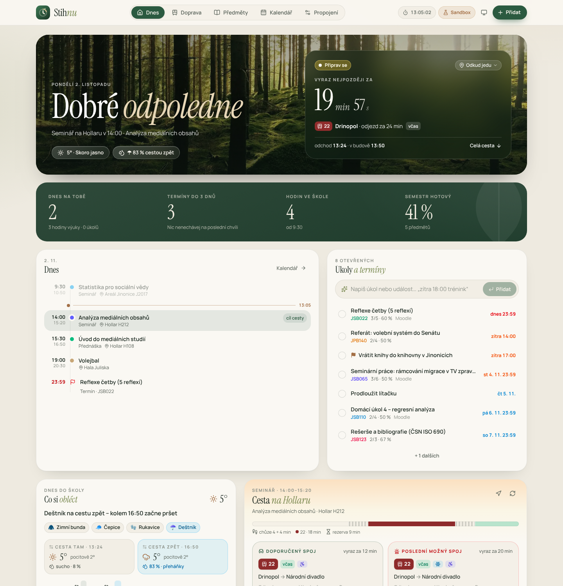
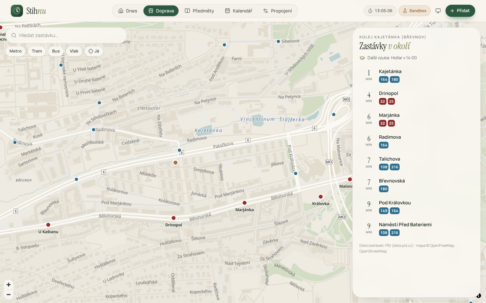
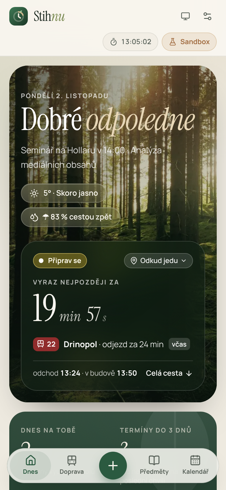
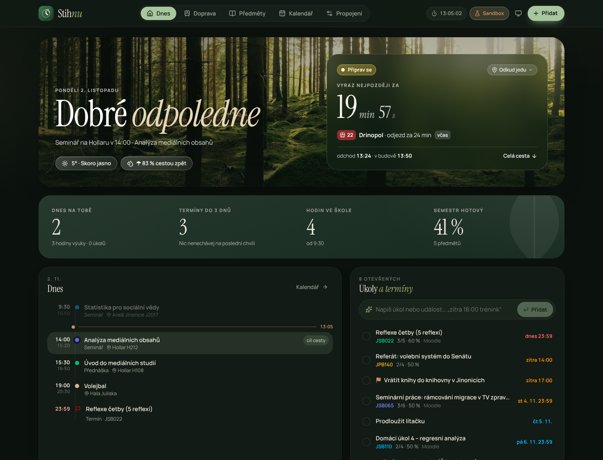

# Stihnu – studium, MHD a Google v jedné aplikaci

PWA pro vysokoškoláky v Praze (primárně Univerzita Karlova – SIS, Moodle, PID). Všechno, co student potřebuje,
na jednom klidném místě: **rozvrh ze SISu, úkoly z Moodlu, vlastní úkoly a události, Google Kalendář, Úkoly a Disk
(oboustranně), mapa zastávek MHD s živými odjezdy, počasí na cestu** a velký odpočet do odchodu na poslední spoj.



| Mapa zastávek | Mobil | Tmavý režim |
| --- | --- | --- |
|  |  |  |

> Při prvním otevření tě provede **průvodce nastavením** – krok za krokem, každý krok jde přeskočit.
> Počasí a doprava PID (trasy, přestupy, živá zpoždění) fungují **hned, bez klíčů a přihlašování**.
> Kdo si chce aplikaci jen prohlédnout, zvolí **Ukázku** (vymyšlená data, poznáš ji podle pruhovaného pásu).

**Open source (MIT).** Kód je veřejný, aby si každý mohl ověřit, co aplikace s daty dělá – a aby mohla používat
komunitní služby jako [Transitous](https://transitous.org).

---

## Co umí

### Dnes
- **Fotka podle denní doby** a pozdrav; skleněná karta „**Vyraz nejpozději za 19 min**“ s linkou, zastávkou, zpožděním a časem příchodu.
- **Rada na cestu**: co si obléct (bunda, čepice, deštník…) podle pocitové teploty a toho, jestli bude pršet **cestou tam
  a cestou zpět** – okna cest se počítají z rozvrhu a z plánu MHD. Graf teploty a srážek na 12 hodin. Data z [Open-Meteo](https://open-meteo.com).
- **Časová osa dne**: výuka, vlastní události, události z Google Kalendáře, úkoly a termíny s ukazatelem „teď“.
- **Úkoly a termíny** s rychlým zadáním přirozenou češtinou:
  `zítra 18:00 trénink @Strahov`, `esej do pátku #JSB065 !`, `pá 10–12 konzultace na Hollaru`, `koupit lítačku za 3 dny`.
- Pás s čísly (dnes na tobě, termíny do 3 dnů, hodiny ve škole, hotový semestr), předměty s prstenci, harmonogram.

### Doprava
- **Mapa všech 1 483 pražských zastávek** (MapLibre + OpenFreeMap, přebarvená do palety aplikace), hledání bez diakritiky,
  filtry metro/tram/bus/vlak, zastávky v okolí podle pěší vzdálenosti.
- Po kliknutí na zastávku **odjezdová tabule** (Golemio živě, v Sandboxu simulace) se zpožděním, klimatizací a bezbariérovostí.
- **„Jet odsud“** – vybraná zastávka se použije při plánování cesty (jinak se hledá automaticky nejrychlejší spoj z okolí).
- Zpětný výpočet trasy: `začátek − rezerva − chůze ze zastávky − jízda (se zpožděním) − chůze na zastávku`, doporučený a poslední možný spoj,
  plán B při zpoždění.

### Předměty a kalendář
- Předměty s váženým progressem, povinnosti s checklisty, materiály (Moodle, vlastní soubory, poznámky), **sylabus ze SISu**.
- Kalendář: časová osa akademického roku, agenda (termíny, úkoly, harmonogram) a týden včetně vlastních událostí.

### Propojení
| Služba | Jak | Co přinese |
| --- | --- | --- |
| **Google Kalendář** | přihlášení Google | rozvrh, zkoušky, harmonogram a vlastní události v kalendáři „Stihnu · studium“ (nebo v hlavním); události z hlavního kalendáře se zobrazí v aplikaci |
| **Google Úkoly** | přihlášení Google | vlastní úkoly a studijní termíny v seznamu „Stihnu“; úkoly z „Moje úkoly“ se stáhnou – odškrtnutí platí oběma směry |
| **Google Disk** | přihlášení Google | data mezi zařízeními (skrytá složka aplikace), volitelně poznámky jako Google dokumenty a soubory podle předmětů |
| **Moodle** | odkaz z *Kalendář → Exportovat kalendář* | úkoly, testy a odevzdávárny – **bez tokenu**, obnovuje se samo |
| **Moodle (plné)** | token *Moodle mobile web service* | navíc materiály, PDF a prezentace z kurzů |
| **SIS – rozvrh** | odkaz z *Rozvrh NG → Export → iCalendar* | předměty, časy, místnosti → budovy; obnovuje se samo |
| **SIS – sylaby a zkoušky** | záložka „→ Stihnu“ nebo vložený text | sylabus, podmínky, literatura; termíny zkoušek do kalendáře |
| **PID Golemio** | API klíč | živé odjezdy, zpoždění, klimatizace |

Pokročilé nastavení synchronizace: cílový kalendář/seznam, co zapisovat, směr (obousměrně / jen zapisovat / jen číst),
rozsah, připomínky, barvy předmětů, další zrcadlené kalendáře a seznamy, interval, řešení konfliktů (novější / Stihnu / Google),
promítání smazání a historie běhů.

---

## Rychlý start

Vyžaduje Node.js 20+.

```bash
npm install
```

```bash
npm run dev
```

Aplikace běží na http://localhost:5173 a obsluhuje i serverové funkce `/api/*` (stejný kód jako na Vercelu).

```bash
npm test
```

```bash
npm run build
```

Dataset zastávek se obnovuje z otevřených dat PID:

```bash
npm run stops
```

## Účty (synchronizace mezi zařízeními)

Přihlášení přes Google nebo e-mail, data šifrovaná end-to-end (podrobnosti v [SECURITY.md](SECURITY.md)).
Zapnutí pro správce: Vercel → Storage → Create Database → **Supabase** (region Frankfurt) → připojit k projektu → Redeploy;
v Supabase zapnout poskytovatele Google a nastavit Site URL. Tabulky (`stihnu_vaults`, `stihnu_keys`) i jejich
Row Level Security si aplikace založí sama (SQL je v `server/supabase.ts`). Krok za krokem je to i v aplikaci:
Propojení → Pro správce aplikace.

## Nasazení na Vercel

1. Repozitář na GitHubu → ve Vercelu **Add New → Project → Import**. `vercel.json` nastavuje build, hlavičky i funkce v `api/`.
2. Volitelné proměnné prostředí (**Settings → Environment Variables**):

   | Proměnná | K čemu |
   | --- | --- |
   | `VITE_GOOGLE_CLIENT_ID` | OAuth Client ID pro Google (Kalendář, Úkoly, Disk) – pak ho není potřeba vkládat v aplikaci |
   | `GOOGLE_CLIENT_ID` + `GOOGLE_CLIENT_SECRET` | trvalé přihlášení: server drží refresh token v šifrované HttpOnly cookie a synchronizace běží i na pozadí |
   | `GOOGLE_TOKEN_SECRET` | volitelný vlastní klíč pro šifrování cookie (jinak se odvodí z client secret) |
   | `GOLEMIO_API_KEY` | nepovinné – PID Golemio přidá klimatizaci a bezbariérovost vozů ([api.golemio.cz](https://api.golemio.cz/api-keys)); trasy a zpoždění fungují i bez něj přes Transitous |
   | `GOOGLE_MAPS_API_KEY` | Google Routes API – trasy s přestupy |
   | `ANTHROPIC_API_KEY` | AI zpřesnění parseru harmonogramu a sylabů |
   | `PROXY_ALLOWED_HOSTS` | allowlist domén pro Moodle/iCal proxy, např. `*.cuni.cz,calendar.google.com` |

3. Deploy. PWA jde nainstalovat (Přidat na plochu) a funguje offline.

## Propojení s Googlem (jednorázově, ~5 minut)

1. [Google Cloud Console](https://console.cloud.google.com/projectcreate) → založ projekt.
2. **APIs & Services → Library**: zapni *Google Calendar API*, *Google Tasks API* a *Google Drive API*.
3. **OAuth consent screen**: typ *External*, stav *Testing*, do *Test users* přidej svůj Gmail.
4. **Credentials → Create credentials → OAuth client ID → Web application**:
   - *Authorized JavaScript origins*: `https://prazskystudent.vercel.app` a `http://localhost:5173`.
   - Pro trvalé přihlášení (volitelné) ulož i *Client secret* do Vercelu jako `GOOGLE_CLIENT_SECRET` a Client ID jako `GOOGLE_CLIENT_ID`.
5. Client ID vlož v aplikaci (**Propojení → Google**), nebo ho nastav jako `VITE_GOOGLE_CLIENT_ID` a znovu nasaď.
6. V aplikaci přepni na **Live** a klikni **Propojit s Googlem**.

Oprávnění: `calendar`, `tasks`, `drive.file` (jen soubory vytvořené aplikací) a `drive.appdata` (skrytá složka aplikace).
Žádá se jen o zapnuté služby. Přístup jde kdykoli odebrat v [účtu Google](https://myaccount.google.com/connections).

### Jak synchronizace funguje
- Každá propojená položka má vazbu s otiskem lokální i vzdálené podoby; změna se pozná porovnáním otisků. Když se změní obě strany,
  rozhodne nastavená politika (výchozí: novější změna).
- Položky ze Stihnu nesou značku (`extendedProperties` u událostí, patička poznámky u úkolů), takže ani na novém zařízení nevznikají duplikáty.
- Smazání se promítá jen při výslovném smazání (tombstone). Když se změní rozvrh, zastaralé kopie se uklidí – a pokud by šlo o hromadné
  mazání, aplikace se nejdřív zeptá. Výuka smazaná v Googlu se v aplikaci nesmaže, jen se přestane zapisovat.
- Disk: data se slučují po položkách podle `updatedAt` a tombstones, takže se nic neztratí ani při práci na dvou zařízeních.
- Sandbox používá simulovaný Google uložený v prohlížeči (s tlačítkem „Simulovat změnu v Googlu“) – do skutečného účtu se nic nezapíše.

## Moodle bez tokenu
Klíč *Moodle mobile web service* se v **Předvolby → Klíče zabezpečení** objeví až po prvním přihlášení v oficiální aplikaci Moodle;
RSS klíč k tomu nefunguje. Proto je doporučená cesta **export kalendáře**:
Moodle → **Kalendář → Exportovat kalendář** → *Všechny události*, *Nedávné a příští* → **Získat URL kalendáře** → vložit do Stihnu.
Odkaz (`…/calendar/export_execute.php?userid=…&authtoken=…`) se stahuje přes serverovou iCal proxy a obnovuje se v nastaveném intervalu.

## SIS
- **Rozvrh**: odkaz na export iCalendar z Rozvrhu NG se obnovuje sám (výchozí každých 6 h) a změny se propíšou i do Google Kalendáře.
- **Sylaby a termíny zkoušek**: v *Propojení → SIS* přetáhni tlačítko **→ Stihnu** do lišty záložek. Na stránce předmětu nebo termínů
  zkoušek v SISu na záložku klikni – otevře se Stihnu a stránku přečte (přihlášení zůstává v SISu, data se předávají jen mezi tvými okny,
  aplikace přijímá zprávy jen z domén `*.cuni.cz`). Alternativa: zkopírovat text stránky do *Import ze SISu*.
- Aplikace sama SIS nestahuje a neobchází jeho přihlášení ani ochrany.

## Ukázka vs. moje data

V aplikaci se režimy jmenují **Ukázka** (dříve Sandbox) a **Moje data** (dříve Live). Přepnutím na vlastní data se ukázka
smaže; nahrání vlastního rozvrhu přepne samo. Vlastní data se s ukázkovými nikdy nemíchají.

| | Ukázka | Moje data |
| --- | --- | --- |
| Čas | simulovaný, start ve 13:05 (posouvání v hlavičce) | reálný |
| Poloha | Kolej Kajetánka a další místa | GPS, záložní místo |
| Doprava | simulace PID (tramvaje 22 a 2, metro A/B/C + obecné odjezdy pro všechny zastávky) | Transitous (jízdní řády PID + živá zpoždění), volitelně Golemio |
| Google | simulovaný účet se svátky, brigádou a úkoly | tvůj účet |
| Moodle, SIS | ukázkové exporty ve formátu skutečných služeb | serverové proxy |
| Počasí | Open-Meteo (simulace bez sítě) | Open-Meteo |

## Bezpečnost a soukromí
- Data jsou v zařízení (localStorage, soubory v IndexedDB); s Googlem jen to, co zapneš. Access token Google se drží jen v paměti.
- Serverové přihlášení: refresh token je zašifrovaný AES-256-GCM v cookie `HttpOnly; SameSite=Strict`, endpoint vyžaduje vlastní hlavičku.
- Proxy `/api/*` chrání proti SSRF (jen `https`, kontrola DNS i u přesměrování, limity velikosti a času), Moodle proxy povoluje jen čtecí funkce.
- Záloha (export JSON) neobsahuje API klíče ani Moodle token.

## Struktura projektu

```
api/                 Vercel Functions (tenké obálky nad server/)
server/              proxy: golemio, moodle, ics, routes, aiParse, google (OAuth), health; SSRF ochrana
scripts/             build-stops (dataset PID), generate-icons
src/
  types.ts           doménový model
  lib/               čistá logika: ics, icsImport, moodleIcs, sisImport, quickAdd, weather, stops, transitPlanner, …
  lib/sync/          synchronizační engine (Kalendář, Úkoly), Disk (slučování), mapování, klíče
  services/          api.ts (Sandbox/Live), google/ (auth, REST klient, simulace), syncCenter, weather, stops, sisBridge, demo/
  store/             Zustand: appStore (persistováno, migrace v1 → v2), clockStore, uiStore
  components/        dashboard, transit, map, weather, subjects, calendar, integrations, common, layout, ui
  test/              Vitest – sync engine, Disk, počasí, Moodle iCal, SIS, zastávky, rychlé zadání, ICS, parser, MHD
public/              manifest, service worker, ikony, fotky, data/stops-praha.json
```

Podrobně v [ARCHITECTURE.md](ARCHITECTURE.md).

## Zdroje dat a poděkování
Trasy a odjezdy: [Transitous](https://transitous.org) ([zdroje dat](https://transitous.org/sources/)) – komunitní plánovač
nad jízdními řády PID; Stihnu ho používá podle jeho pravidel (open source, nekomerčně, s cache a identifikací v User-Agent).
Zastávky: [PID – data.pid.cz](https://data.pid.cz) · mapové podklady: [OpenFreeMap](https://openfreemap.org), © přispěvatelé
[OpenStreetMap](https://www.openstreetmap.org/copyright) · počasí: [Open-Meteo](https://open-meteo.com) (CC BY 4.0) ·
fotografie: [Unsplash](https://unsplash.com) · písma: Instrument Serif, Manrope (SIL OFL).

## Známá omezení
- Google funkce potřebují vlastní OAuth Client ID (aplikace v režimu *Testing* je jen pro přidané testovací uživatele).
- Bez `GOOGLE_CLIENT_SECRET` platí přihlášení Google asi hodinu; potom stačí kliknout na „Potvrdit“ v Propojení.
  Aplikace v režimu *Testing* v Google Cloud ruší přihlášení po 7 dnech – pro trvalé propojení ji přepni na *In production*.
- Transitous je komunitní služba bez záruky; když neodpovídá, plánovač použije Golemio (s klíčem) nebo odhad podle vzdálenosti.
  Při větším počtu uživatelů (stovky dotazů denně) je slušné se ozvat v jejich Matrix kanálu.
- Rozpoznání stránek SISu stojí na jejich textu – při změně vzhledu SISu může být potřeba parser doladit.

## Licence
[MIT](LICENSE) · bezpečnost: [SECURITY.md](SECURITY.md)
